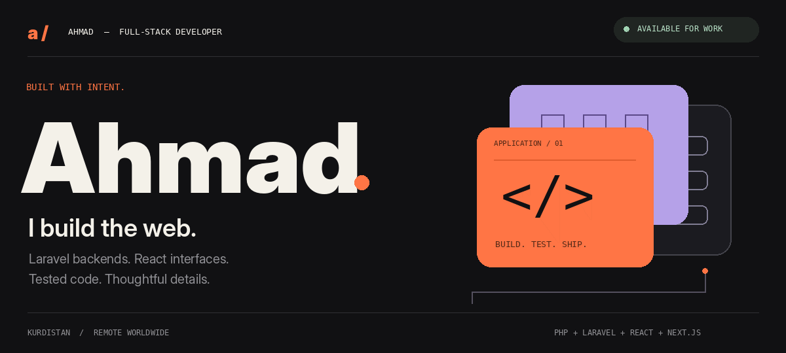
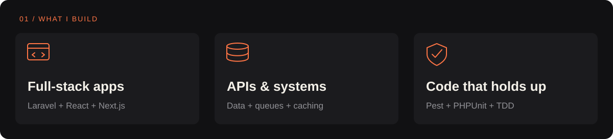
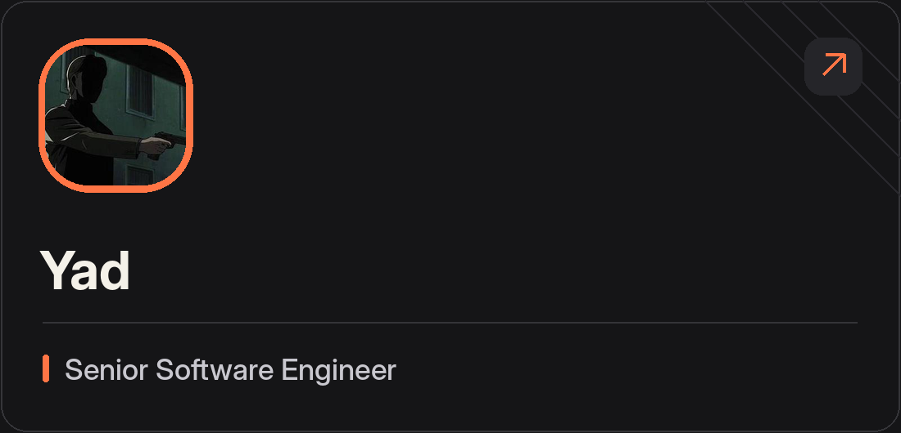
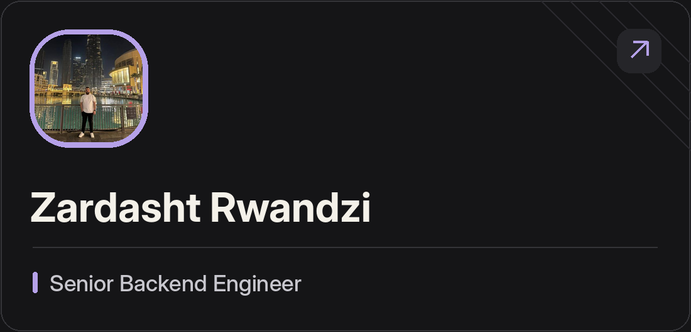

  

<strong>🟢 Available for freelance projects &amp; remote work</strong>

  
  
  

<strong>COMMITTERS.TOP / KURDISTAN</strong>

  
  &nbsp;
  

<a href="https://committers.top/kurdistan">Public commits leaderboard ↗</a> &nbsp; / &nbsp; <a href="https://committers.top/kurdistan_private">All contributions leaderboard ↗</a>

 

 

<h2 align="center">The tools behind the work.</h2>

BACKEND &amp; DATA

FRONTEND &amp; INTERFACES

WORKFLOW &amp; TOOLING

  
  
  

 

<h2 align="center">My Teachers</h2>

  
  

 

<a href="mailto:ahmaddmuhammad03@gmail.com"><strong>ahmaddmuhammad03@gmail.com</strong></a> &nbsp; · &nbsp; <a href="https://t.me/a4hmad1">@a4hmad1 on Telegram ↗</a>

