  

  
  
  

 

### 01 / The developer behind the code

I'm **Ahmad**, a full-stack developer based in **Kurdistan**. I build web applications with **Laravel, React, and Next.js**, connecting thoughtful interfaces to reliable backend systems.

My approach is straightforward: understand the problem, keep the architecture clear, and test the behavior that matters. I practice **TDD with Pest and PHPUnit**, and keep sharpening my craft through **Laracasts**.

**Currently available for freelance projects, MVP builds, and remote engineering roles.**

 

### 02 / From interface to infrastructure

| Layer | My toolkit | What I focus on |
| :--- | :--- | :--- |
| **Interface** | React · Next.js · TypeScript · Tailwind CSS | Responsive, accessible web experiences |
| **Application** | PHP · Laravel · REST APIs | Clear boundaries and maintainable business logic |
| **Data** | MySQL · PostgreSQL · Redis · SQLite | Efficient queries, caching, and background jobs |
| **Quality** | Pest · PHPUnit · TDD | Confidence through unit and feature tests |
| **Workflow** | Git · Linux · Docker · Postman | Repeatable development and practical tooling |

 

### 03 / How I can help

<table>
  <tr>
    <td width="50%" valign="top">
      <h3>↗ Launch your idea</h3>
      
Turn a product concept into a full-stack application with Laravel, React, or Next.js. A clear foundation for your next MVP.

    </td>
    <td width="50%" valign="top">
      <h3>⌘ Build the backend</h3>
      
REST APIs, relational data models, caching, and asynchronous queues that support the experience your users see.

    </td>
  </tr>
  <tr>
    <td valign="top">
      <h3>✓ Ship with confidence</h3>
      
Meaningful Pest and PHPUnit coverage for critical workflows, with tests that make future changes easier.

    </td>
    <td valign="top">
      <h3>⤴ Improve what exists</h3>
      
Refactor legacy code, optimize database queries, and simplify application structure as your product evolves.

    </td>
  </tr>
</table>

 

### 04 / People who shaped my craft

Good engineering is learned from good people. Grateful to my teachers for their guidance and the standards they inspire.

<table>
  <tr>
    <td width="80" align="center"></td>
    <td><strong><a href="https://github.com/ravensborn">Yad · @ravensborn</a></strong> Lessons in test-driven development and thoughtful testing.</td>
  </tr>
  <tr>
    <td align="center"></td>
    <td><strong><a href="https://github.com/codezardasht">Zardasht Rwandzi · @codezardasht</a></strong> Lessons in Eloquent and backend architecture. <a href="https://technobase.krd/">TechnoBase ↗</a></td>
  </tr>
</table>

 

  
<strong>Elsewhere / Community rankings</strong>

   
  
  

 

---

  <h2>Have an idea worth building?</h2>
  
Let's talk about your product, your challenges, and what comes next.

  
<a href="mailto:ahmaddmuhammad03@gmail.com"><strong>ahmaddmuhammad03@gmail.com ↗</strong></a> &nbsp; · &nbsp; <a href="https://t.me/a4hmad1">Telegram ↗</a>

  KURDISTAN → WHEREVER YOUR NEXT PROJECT IS.

