  

  
  
  

 

<strong>⚡ THE TOOLKIT</strong>

  

  

FULL-STACK APPLICATIONS &nbsp; / &nbsp; CLEAN ARCHITECTURE &nbsp; / &nbsp; TEST-DRIVEN DEVELOPMENT

 

 

<strong>✦ THE PEOPLE BEHIND THE PROGRESS</strong> Grateful to the mentors who shaped my craft.

  
  &nbsp;&nbsp;&nbsp;&nbsp;&nbsp;
  

<a href="https://github.com/ravensborn">Yad · Testing &amp; TDD</a> &nbsp; ✦ &nbsp; <a href="https://github.com/codezardasht">Zardasht · Eloquent &amp; Architecture</a>

 

<a href="mailto:ahmaddmuhammad03@gmail.com">ahmaddmuhammad03@gmail.com</a> &nbsp; / &nbsp; <a href="https://t.me/a4hmad1">@a4hmad1</a>

  
🏆 Community rankings

   
  
  

